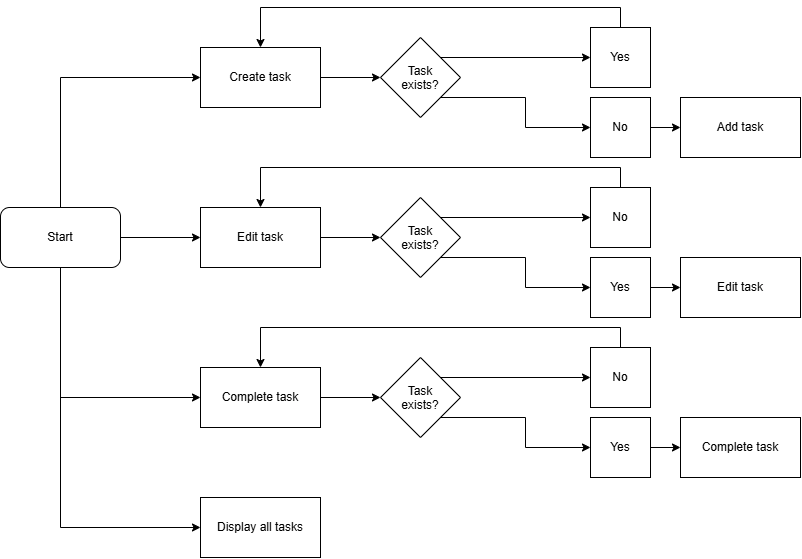

# Terminal TaskR

A terminal-based task manager and to-do list.

## The Problem

Normally we have our tasks on our phone, but simply opening our phones
can be a risk for distraction. So, I thought to make a task manager with
the most minimalistic tool I could think of: the terminal.

## How It Works

This program simply creates, edits, and deletes tasks into a text file
and displays it out for you to see.



## Tech Stack

- **Language:** Bash
- **External tools:** jq, grep, cron

## Setup

```bash
git clone https://github.com/psingh-mo/terminal-taskr
cd terminal-taskr
./task.sh
```

## Usage

```bash
./task.sh create task_name
./task.sh edit task_name
./task.sh complete task_name
```

## Roadmap

- [ ] Create categories/headers for tasks
- [ ] Ability to add tags to group categories of tasks
- [ ] Allow usage of these tags to display and modify tasks/categories

## Author

[Prakhar Singh](https://github.com/psingh-mo)

## License

MIT
